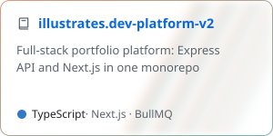
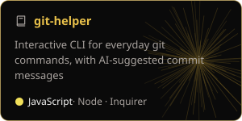
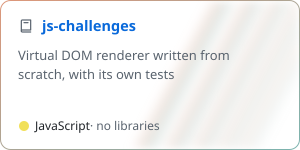
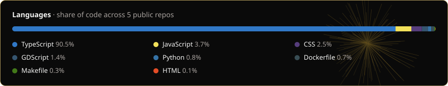
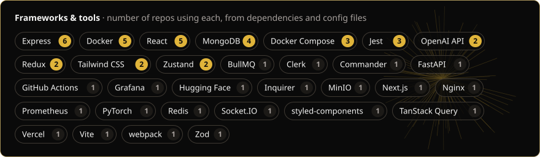
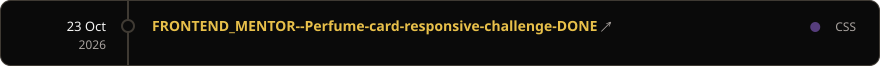
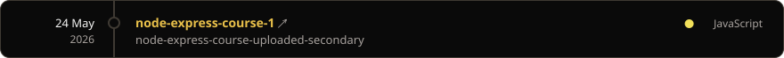
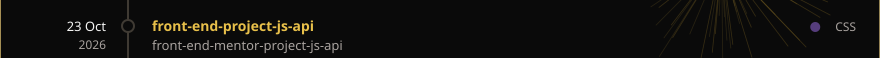

<picture>
  <source media="(prefers-color-scheme: dark)" srcset="assets/banner-dark.svg">
  
</picture>

<a href="https://buymeacoffee.com/maxpavlovs"><picture><source media="(prefers-color-scheme: dark)" srcset="assets/buttons/bmc-dark.svg"></picture></a>
<a href="https://www.patreon.com/maxpavlovs"><picture><source media="(prefers-color-scheme: dark)" srcset="assets/buttons/patreon-dark.svg"></picture></a>
I build web products end to end with TypeScript, React and Node.

<a href="https://client.illustrates.dev/main-dashboard"><picture><source media="(prefers-color-scheme: dark)" srcset="assets/buttons/site-dark.svg"></picture></a>
<a href="https://client.illustrates.dev/blog"><picture><source media="(prefers-color-scheme: dark)" srcset="assets/buttons/blog-dark.svg"></picture></a>
<a href="https://linkedin.com/in/maksym-pavlovskyi-536647267"><picture><source media="(prefers-color-scheme: dark)" srcset="assets/buttons/linkedin-dark.svg"></picture></a>
<a href="https://medium.com/@pavlovskymaxym4"><picture><source media="(prefers-color-scheme: dark)" srcset="assets/buttons/medium-dark.svg"></picture></a>
<a href="mailto:illustrates.service@gmail.com"><picture><source media="(prefers-color-scheme: dark)" srcset="assets/buttons/email-dark.svg"></picture></a>

### Selected work

<a href="https://github.com/makspavlovskyi/illustrates.dev-platform-v2"><picture><source media="(prefers-color-scheme: dark)" srcset="assets/cards/illustrates.dev-platform-v2-dark.svg"></picture></a>
<a href="https://github.com/makspavlovskyi/git-helper"><picture><source media="(prefers-color-scheme: dark)" srcset="assets/cards/git-helper-dark.svg"></picture></a>
<a href="https://github.com/makspavlovskyi/js-challenges"><picture><source media="(prefers-color-scheme: dark)" srcset="assets/cards/js-challenges-dark.svg"></picture></a>

### What I actually use

Measured daily from the code in my public repos: language share from GitHub's byte counts, and frameworks found in each repo's dependencies and config files.

<picture><source media="(prefers-color-scheme: dark)" srcset="assets/generated/languages-dark.svg"></picture>

<picture><source media="(prefers-color-scheme: dark)" srcset="assets/generated/tools-dark.svg"></picture>

### Activity

<!-- activity:start (filled by scripts/update-profile.mjs: one linked card per repo) -->
Recently worked on · last code change in my public repos, click one to open it

<a href="https://github.com/makspavlovskyi/10kWebSite"><picture><source media="(prefers-color-scheme: dark)" srcset="assets/generated/activity-dark-0.svg"></picture></a> 
<a href="https://github.com/makspavlovskyi/node-express-course-1"><picture><source media="(prefers-color-scheme: dark)" srcset="assets/generated/activity-dark-1.svg"></picture></a> 
<a href="https://github.com/makspavlovskyi/illustrates.dev-platform-v2"><picture><source media="(prefers-color-scheme: dark)" srcset="assets/generated/activity-dark-2.svg"></picture></a> 
<a href="https://github.com/makspavlovskyi/java-app"><picture><source media="(prefers-color-scheme: dark)" srcset="assets/generated/activity-dark-3.svg"></picture></a> 
<a href="https://github.com/makspavlovskyi/oaqjp-final-project-emb-ai"><picture><source media="(prefers-color-scheme: dark)" srcset="assets/generated/activity-dark-4.svg"></picture></a>
<!-- activity:end -->

<picture><source media="(prefers-color-scheme: dark)" srcset="https://streak-stats.demolab.com/?user=makspavlovskyi&hide_border=true&theme=dark&background=0A0A0A&ring=E6C361&fire=E6C361&currStreakLabel=E6C361"></picture>

<picture><source media="(prefers-color-scheme: dark)" srcset="https://raw.githubusercontent.com/makspavlovskyi/makspavlovskyi/output/github-snake-dark.svg"></picture>

